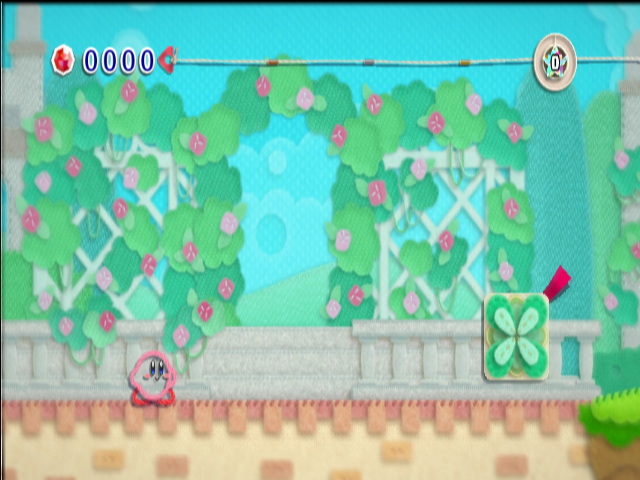

# Kirby's Epic Yarn Recompiled

<a href="https://recomplauncher.com/game/kirby-epic-yarn-recomp"><picture><source media="(prefers-color-scheme: dark)" srcset="https://recomplauncher.com/assets/press/launcher/badge-light.svg"></picture></a>

**A native recompilation of Kirby's Epic Yarn for Windows and Linux (x86-64), built with
[WiiCompiled](https://github.com/patchzyy/Wiicompiled) and
[Aurora](https://github.com/patchzyy/aurora-wiicompiled).**

Play Kirby's Epic Yarn natively on PC with stable gameplay, configurable graphics,
keyboard and controller support, and a dedicated launcher for settings and saves.

The C++ Qt Widgets launcher defaults to English. Open **Basic settings**
for language, fullscreen and volume. Choose English, 简体中文 or Español
from the language selector. Advanced settings contains graphics, custom input
and diagnostics. Hover over a control or a question-mark button for help.
The launcher saves your language choice in
`local/user/launcher-language.txt`. To change Kirby’s language, choose
**Game language** in Basic settings or in RecompLauncher’s game settings.
The USA disc supports English, Français and Español. The choice takes effect
on the next game launch.

Kirby Setup starts in English. Its own language selector switches between
English, 简体中文 and Español, including during installation, and remembers your
choice separately from the launcher.

The Wii executable is translated from PowerPC to C++ and compiled for the host.
The native runtime uses Aurora for graphics (Vulkan on Linux). Dolphin extracts your disc and serves
as a behavior reference; it does not run the native game.



*Kirby's Epic Yarn running natively on Linux.*

> [!IMPORTANT]
> **Get started on Windows or Linux.** The Linux AppImage opens a dedicated
> installer, downloads its build tools once, and builds the game from your own
> supported copy.
> Windows uses an automatic native build script that creates a playable ZIP.
>
> You need your own **USA disc, RK5E01 revision 0**. Game files, generated game
> code, saves and shader caches are not included. Other revisions are rejected.

[Build from source](docs/building.md) · [Features](#features) ·
[Gameplay validation history](docs/gameplay-validation.md) · [Performance](docs/performance.md) ·
[Contributing](CONTRIBUTING.md) ·
[Changelog](CHANGELOG.md)

Third-party launchers: see [Quiver, RecompLauncher and Decomp Buddy](docs/integrations/launchers.md)
for supported platforms, setup requirements and the release integration checklist.

The native game and launcher run on **Windows and Linux**. Choose the setup
instructions for your platform:

| Platform | Setup |
| --- | --- |
| Windows x86-64 | [Automatic PowerShell build and Windows ZIP](docs/building.md#windows-x64) |
| Linux x86-64 | [AppImage installer](#linux-appimage) or [build from source](docs/building.md#linux) |

## Requirements

- Windows x86-64 or Linux x86-64 with a desktop session and working graphics drivers.
- Your own complete RK5E01 Rev 0 dump, including the extracted `files/` tree.
- Linux AppImage: glibc 2.39 or newer, Vulkan graphics drivers, internet access
  for first-installation downloads, and space for extraction and compilation.
- Linux source builds: Git, Python 3.11+ and **Docker or Podman** for the build environment.
- Windows: [tools/windows/build-windows.ps1](docs/building.md#windows-x64) automatically downloads LLVM-MinGW, Python, .NET 8, CMake, Ninja and Windows SDK headers.
- Source builds: Dolphin's `dolphin-tool` / `DolphinTool.exe` for image extraction; 7-Zip only for `.7z` inputs.
  Neither is required for an already extracted DATA folder.
- Several GB of storage and enough memory to compile the generated C++.

Expected `sys/main.dol` SHA-1:
`f4280a2b0709bfde4132be22e9f7fa8ecfa2a130`.

Development hardware includes an **Acer Nitro AN515-55 with an RTX 3050 Laptop
GPU** on Linux and a **Ryzen 5 9600X with an RTX 3060** for celeron633's Windows
port. See the [performance guide](docs/performance.md) for recorded measurements
and hardware details.

## Linux AppImage

Download **[Kirby-Setup-linux-x86_64.AppImage](https://github.com/RivierGrullon/kirby-epic-yarn-recomp/releases/download/v0.1.0-alpha.2/Kirby-Setup-linux-x86_64.AppImage)** (about **58 MB**) and its matching `.sha256` file from
[the release page](https://github.com/RivierGrullon/kirby-epic-yarn-recomp/releases/tag/v0.1.0-alpha.2).
Make it executable in your file manager and open it, or run these commands in the
download directory:

```bash
sha256sum -c Kirby-Setup-linux-x86_64.AppImage.sha256
chmod +x Kirby-Setup-linux-x86_64.AppImage
./Kirby-Setup-linux-x86_64.AppImage
```

Kirby Setup asks for your own supported disc image or complete DATA folder and
an installation folder (default: `~/Games/Kirby Native`). It downloads the build
tools automatically once (about **460 MB**), then extracts, translates, compiles
and verifies the game. Progress, elapsed time, cancellation and retry are shown
in the installer. Separate Python, Qt, compilers, Dolphin and Docker/Podman
installations are not required.

After setup, select **Open launcher** or use **Kirby's Epic Yarn** in the
applications menu. Enable **Also create a desktop shortcut** during setup to
create one on the desktop. `Play Kirby.sh` is also available in your
installation folder.

Download the `Kirby-Setup-*` package for your platform. It includes the
precompiled Qt launcher and its runtime. Setup builds the game and its
native launcher host locally.

If mounting AppImages is unavailable, run:

```bash
./Kirby-Setup-linux-x86_64.AppImage --appimage-extract-and-run
```

Settings, saves and generated builds stay in the chosen installation folder
under `.kirby/<source-version>/`. Compatible installer versions reuse the tools
cache at `$XDG_DATA_HOME/kirby-native/toolchains/` (normally
`~/.local/share/kirby-native/toolchains/`). Saves and settings from older
layouts/source versions are not migrated automatically; keep the previous files
if you need to transfer them. See [Application packages](docs/packaging.md) for
storage and packaging details.

## Build and play from source

Install the [prerequisites](docs/building.md#prerequisites), then run one setup
command from the checkout with the actual path to your own disc or DATA folder:

```bash
python3 tools/setup.py "/actual/path/to/Kirby.wbfs"
```

On Windows, use the [automatic native build](docs/building.md#windows-x64):

```powershell
powershell -NoProfile -ExecutionPolicy Bypass -File .\tools\windows\build-windows.ps1 "D:\Games\Kirby.wbfs"
```

It downloads its own toolchain and builds directly with LLVM-MinGW, without
Docker or Podman. An extracted `main.dol` is also accepted for compilation;
playing still requires the complete DATA folder.
After building, extract `local/releases/Kirby-Windows-x64.zip` to use the compiled
game outside the checkout. Use `tools/windows/build-windows.ps1 -PackageOnly` to package it again.

For the Linux setup command above:
If `disc/DATA` is already extracted, omit the path. Use `--engine docker` or
`--engine podman` to choose explicitly, or `--check` to check prerequisites first.
Setup prepares tools, translates, compiles and verifies the game and launcher.
See the [build guide](docs/building.md) for the full first-installation flow.

From a completed local build, run:

```bash
build/native/kirby-launcher
```

On Windows, open `build\native\kirby-launcher.exe`.

The launcher lets you:

- Open the standalone installer to import a disc image or DATA folder and build/update the game.
- Detect a verified native installation and its game data.
- Start the native game in a visible window.
- Set master volume and VSync for the next launch.
- Start in borderless fullscreen under **Display**, or press **Alt+Enter** while playing to toggle modes for that session.
- Select 1x–6x and 8x internal rendering resolution and Off/FXAA/4x MSAA/4x MSAA + FXAA under **Display**.
- Rebind gamepad buttons, stick/trigger directions and keyboard keys, with
  conflict detection, swapping and reset.
- **Experimental performance mode** starts enabled to reduce GPU copy waits and repeated
  texture validation. VSync starts disabled.
- Display detected controllers and open saves, logs and the build guide.

These actions are organized into **Play**, **Install**, **Display**, **Audio**,
**Controls**, **Saves** and **Diagnostics**. Navigation uses a sidebar on wider
windows and tabs on compact windows. Settings saving stays available on every
page. In application packages, the Install page opens the standalone Kirby Setup
installer. Source checkouts can use `tools/setup.py` for toolchain and launcher
preparation.

Settings are shared with the native game and saved on **Save settings**, **Play**,
or closing the launcher. Changes apply on the next game launch. Existing launcher
preferences migrate automatically while retaining the original file. See the
[settings guide](docs/settings.md) for the format and recovery instructions.
Packaged installations use Kirby Setup for imports, builds and updates.
Per-device input profiles and a validated 30/60 FPS selector are
not available in the launcher yet.

## Controls

Default gamepad mappings:

| Gamepad position | Wii action |
| --- | --- |
| D-pad | Movement |
| South button / PlayStation Cross | Wii 2: confirm and jump |
| East button / PlayStation Circle | Wii 1: yarn action |
| Start / Options | Plus: menu |
| Back / Share | Minus: map or controls |

Default keyboard controls are arrow keys for movement, Space for jump/confirm,
Left Ctrl for yarn/cancel, Escape for Plus, Tab for Minus, X/Z for Wii A/B and F1
for Home. Open **Controls** to change these mappings. Gamepad bindings apply to
all players; keyboard bindings apply to player 1. See the
[settings guide](docs/settings.md#control-bindings) for capture and conflict handling.

Automated virtual SDL tests cover standard, PS5, Xbox 360 and Xbox One presets, release
and unplug behavior. See the [settings guide](docs/settings.md#control-bindings)
for controller configuration and troubleshooting.

**Controls > Gyroscope & gravity / tilt** configures controller tilt, gyro or
right-stick aiming, sensitivity, inversion, deadzones and gyro calibration, with
a live sensor preview. There is no in-game settings overlay. Click the right
stick to recenter; optional keyboard motion uses Q/E to tilt and R to recenter.
Gyro mode falls back to the mouse when no gyro data is available.
See [motion settings](docs/settings.md#motion-controls) for configuration details.

## Features

| Area | Features |
| --- | --- |
| Gameplay | Stable native gameplay on Windows and Linux |
| Graphics | Aurora rendering, 1x–6x and 8x internal resolution, FXAA and 4x MSAA |
| Audio | Native game audio with adjustable master volume |
| Controls | Keyboard and gamepad remapping, tilt, gyro and right-stick aiming |
| Saves | Native save system with access to the save folder from the launcher |
| Launcher | Installation, game launch, graphics, audio, controls and diagnostics |
| Installation | Linux AppImage installer and automatic Windows build with ZIP packaging |

Performance depends on hardware, scene and graphics settings. See the
[performance guide](docs/performance.md) for measurements and tuning details.

## Saves and local files

When launched from the repository root:

| Data | Location |
| --- | --- |
| Game save | `local/user/nand/title/00010000/524b3545/data/` |
| Shared launcher/game settings | `local/user/settings.toml` |
| Previous launcher settings (retained after migration) | `local/user/launcher.cfg` |
| Shader cache | `local/user/aurora/` |
| Launcher game log | `build-logs/launcher-game.log` |

Back up saves before testing development changes. Launching the executable from a
different working directory uses a different local user directory.

**Managing saves:** open **Saves** in the launcher.

- **Import** replaces the current save (after a confirmation) from a Dolphin `Wii` folder,
  an RK5E01 title-data folder, or a Dolphin `data.bin` save export. It requires `FLF.bin`,
  replaces only the RK5E01 save directory, and rejects another game's save and Dolphin
  memory-card (`.gci`/`.raw`) data.
- **Export** writes the current save either as a folder of raw files or as a Dolphin
  `data.bin` (AES-encrypted with the Wii SD key). The `.bin` round-trips with this launcher
  and imports into Dolphin; its save banner is blank because the recomp stores no banner.
- **Backups** lists every previous save by the date it was replaced. Restore swaps the
  current save for one of them (backing up the current save first) and Delete removes it.
  Only the 10 most recent backups are kept.

## Documentation

- [Application packaging](docs/packaging.md)
- [Building and updating](docs/building.md)
- [Performance and audio findings](docs/performance.md)
- [Runtime organization](runtime/README.md)
- [Reference ports and reuse decisions](docs/references.md)
- [Bring-up evidence](docs/bringup.md) and [historical diagnostics](docs/diagnostics.md)
- [Contributing and reporting bugs](CONTRIBUTING.md)

## Credits and license

- **[celeron633](https://github.com/celeron633)** — Windows runtime contributions, widescreen presentation and controller motion support.
- **Swiftshine/key** — community decompilation, revision information and symbols.
- **WiiCompiled** — PowerPC translation and shared native runtime.
- **Aurora** — graphics and host integration.
- **WarioRecomp**, **New Super Paper Bros.**, **NSMBWiicompiled** and the other
  [reviewed ports](docs/references.md) — build and runtime references.
- **Dolphin contributors** — extraction tools and hardware behavior references.

Authored code is **GPL-3.0-only**; dependencies retain their own licenses. See
[LICENSE](LICENSE) and [third-party attribution](THIRD_PARTY.md).
Documentation screenshots show the original game running locally; the code
license does not grant rights to Nintendo's artwork or trademarks.

This is an unofficial project, not affiliated with Nintendo or Good-Feel.
