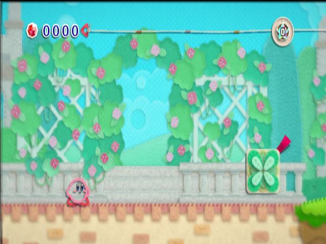

# Kirby's Epic Yarn Recompiled

**A native Linux x86-64 port of Kirby's Epic Yarn, built with
[WiiCompiled](https://github.com/patchzyy/Wiicompiled) and
[Aurora](https://github.com/patchzyy/aurora-wiicompiled).**

The Wii executable is translated from PowerPC to C++ and compiled for the host.
The native runtime uses Vulkan for graphics. Dolphin extracts your disc and serves
as a behavior reference; it does not run the native game.



*Fountain Gardens in the development build. A screenshot demonstrates rendering,
not stable frame pacing or full-game compatibility.*

> [!IMPORTANT]
> **Development source preview, not a finished release.** The main menu, Patch
> Castle completion, save reload and Fountain Gardens movement/jumping have been
> observed. The full game, physical controllers and sustained performance still
> need validation. There is no ready-to-play binary package.
>
> You need your own **USA disc, RK5E01 revision 0**. Game files, generated game
> code, saves and shader caches are not included. Other revisions are rejected.

[Build from source](docs/building.md) · [Known limitations](#known-limitations) ·
[Performance](docs/performance.md) · [Contributing](CONTRIBUTING.md) ·
[Changelog](CHANGELOG.md)

## Requirements

- Linux x86-64 with a desktop session and a working Vulkan driver.
- Your own complete RK5E01 Rev 0 dump, including the extracted `files/` tree.
- Git, Python 3 and rootless Podman for the build environment.
- Dolphin's `dolphin-tool` for extraction; 7-Zip for a `.7z` containing a WBFS.
- Several GB of storage and enough memory to compile the generated C++.

Expected `sys/main.dol` SHA-1:
`f4280a2b0709bfde4132be22e9f7fa8ecfa2a130`.

The target handheld is a **Lenovo Legion Go with Bazzite**. Current graphics and
performance measurements were taken on an **Acer Nitro AN515-55 with an RTX 3050
Laptop GPU**. Legion Go performance has not yet been measured.

## Build and play

Follow the [build guide](docs/building.md) to fetch the pinned dependencies,
extract and verify your copy, translate the DOL and compile the runtime.

From a completed local build, run:

```bash
build/native/kirby-launcher
```

The launcher can currently:

- Select and verify an extracted DATA folder.
- Start the native game in a visible window.
- Set master volume and VSync for the next launch.
- Rebind gamepad buttons, stick/trigger directions and keyboard keys, with
  conflict detection, swapping and reset.
- Enable **Experimental performance mode** to reduce GPU copy waits and repeated
  texture validation.
- Display detected controllers and open saves, logs and the build guide.

These actions are organized into **Play**, **Install**, **Display**, **Audio**,
**Controls**, **Saves** and **Diagnostics**. Navigation uses a sidebar on wider
windows and tabs on compact windows. Settings saving stays available on every
page. The Install page currently selects an extracted folder and opens the build
guide; it does not import or compile a dump yet.

Settings are shared with the native game and saved on **Save settings**, **Play**,
or closing the launcher. Changes apply on the next game launch. Existing launcher
preferences migrate automatically while retaining the original file. See the
[settings guide](docs/settings.md) for the format and recovery instructions.
Archive import, toolchain
setup, translation and compilation are currently command-line steps. Resolution
scaling, per-device input profiles, motion configuration and a validated 30/60 FPS
selector are not available in the launcher yet.

## Controls

Current default gamepad mappings:

| Gamepad position | Wii action |
| --- | --- |
| D-pad | Movement |
| South button / PlayStation Cross | Wii 2: confirm and jump |
| East button / PlayStation Circle | Wii 1: yarn action |
| Start / Options | Plus: menu |
| Back / Share | Minus: map or controls |

Default keyboard controls are arrow keys for movement, Space for jump/confirm,
Left Ctrl for yarn/cancel, Escape for Plus, Tab for Minus, X/Z for Wii A/B and F1
for Home. Open **Controls** to change these mappings. Gamepad bindings apply to
all players; keyboard bindings apply to player 1. See the
[settings guide](docs/settings.md#control-bindings) for capture and conflict handling.

Automated virtual SDL tests cover standard, PS5, Xbox 360 and Xbox One presets,
release and unplug behavior. Physical DualSense input and directional reports
still need resolution. These mappings are not a claim that every controller has
been tested. Per-device profiles, motion, player assignment and physical
reconnection/cooperative play still need implementation or validation.

## Known limitations

| Area | Current status |
| --- | --- |
| Game progression | Menu, Patch Castle and Fountain Gardens observed; whole-game completion unverified |
| Performance | Scene dependent; experimental optimizations are available, but stable 30/60 FPS is not guaranteed |
| Audio | Music tempo verified in a three-minute Fountain Gardens clip; long-session quality and broader synchronization remain unverified |
| Input | Virtual mappings tested; physical controllers and Legion Go controls need validation |
| Graphics | Native GX/VI rendering through Aurora; some formats and display modes remain unsupported |
| Saves | Creation and independent reload verified; broad compatibility testing pending |
| Distribution | Source-tree build and launcher; no portable installer or public binary release |

The window's FPS counter measures Aurora presentations. It does not establish
correct simulation speed or audio synchronization. See the
[measurements and test conditions](docs/performance.md) before comparing results.

## Saves and local files

When launched from the repository root:

| Data | Location |
| --- | --- |
| Game save | `local/user/nand/title/00010000/524b3545/data/` |
| Shared launcher/game settings | `local/user/settings.toml` |
| Previous launcher settings (retained after migration) | `local/user/launcher.cfg` |
| Shader cache | `local/user/aurora/` |
| Launcher game log | `build-logs/launcher-game.log` |

Back up saves before testing development changes. Launching the executable from a
different working directory uses a different local user directory.

## Documentation

- [Building and updating](docs/building.md)
- [Performance and audio findings](docs/performance.md)
- [Runtime organization](runtime/README.md)
- [Reference ports and reuse decisions](docs/references.md)
- [Bring-up evidence](docs/bringup.md) and [historical diagnostics](docs/diagnostics.md)
- [Contributing and reporting bugs](CONTRIBUTING.md)

## Credits and license

- **Swiftshine/key** — community decompilation, revision information and symbols.
- **WiiCompiled** — PowerPC translation and shared native runtime.
- **Aurora** — graphics and host integration.
- **WarioRecomp**, **New Super Paper Bros.**, **NSMBWiicompiled** and the other
  [reviewed ports](docs/references.md) — build and runtime references.
- **Dolphin contributors** — extraction tools and hardware behavior references.

Authored code is **GPL-3.0-only**; dependencies retain their own licenses. See
[LICENSE](LICENSE) and [third-party attribution](THIRD_PARTY.md).
Documentation screenshots show the original game running locally; the code
license does not grant rights to Nintendo's artwork or trademarks.

This is an unofficial project, not affiliated with Nintendo or Good-Feel.
